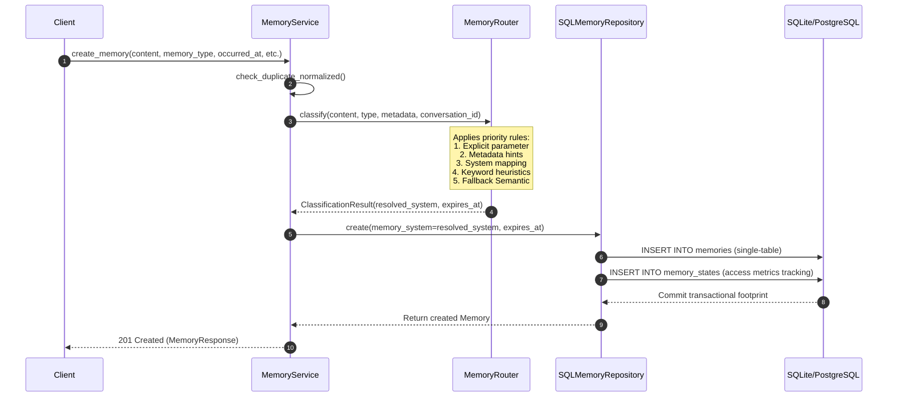
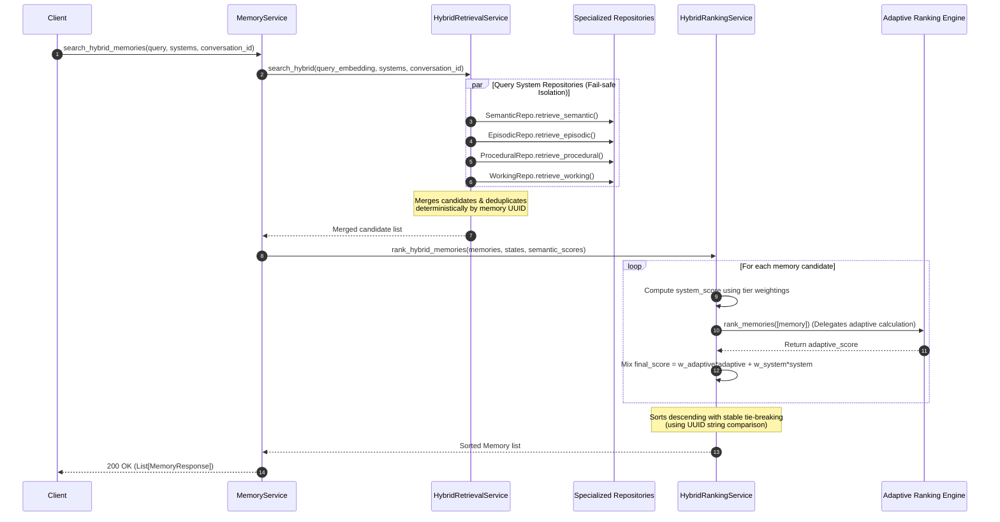
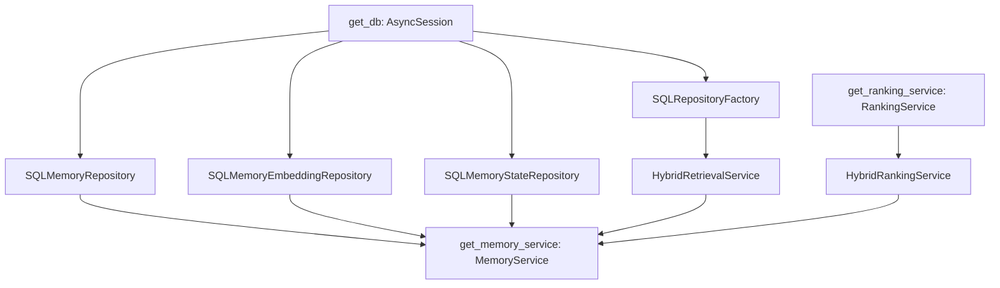

# Hybrid Memory System Architecture Guide

This document describes the design, implementation, and integration of the **Hybrid Memory System** (Milestone 7) in the **Adaptive Memory Engine (AME)**.

---

## 1. Architectural Overview

AME's Hybrid Memory System transforms semantic memory into an adaptive long-term memory system. Instead of relying solely on semantic similarity vector search, the engine routes, retrieves, and ranks context across four distinct cognitive systems:

1. **Semantic Memory**: Factual, general knowledge, user preferences, and declarations.
2. **Episodic Memory**: Time-anchored, chronological conversation events and experiences.
3. **Procedural Memory**: Habit loops, workflows, execution rules, and task instructions.
4. **Working Memory**: Transient session context, current discussion focus, and quick-decay buffers.

---

## 2. Sequence Diagrams

### 2.1 Memory Insertion & Classification Flow

The sequence below illustrates how a memory is processed, routed, and persisted transactionally:



---

### 2.2 Hybrid Retrieval & Ranking Flow

The sequence below illustrates how unified retrieval and system-aware ranking are executed:



---

## 3. Dependency Injection Graph

FastAPI constructs and resolves AME dependencies cleanly in the presentation layer:



---

## 4. Bounded Context Integration

The Hybrid Memory system integrates directly with other AME subsystems:

*   **Semantic Search**: Semantic vector search is encapsulated inside `SQLSemanticMemoryRepository.retrieve_semantic`, utilizing local `sqlite-cosine` distance or native PostgreSQL `pgvector` indexing.
*   **Adaptive Ranking Engine**: The baseline `RankingService` remains the authoritative source for decay penalties, logarithmic access frequencies, and recency coefficients. The `HybridRankingService` acts as a decorator/wrapper layer on top of it.
*   **Autonomous Memory Extraction**: Newly extracted candidates from conversation streams are routed through `MemoryService.create_memory` and classified automatically. The extraction endpoints inject the new dependencies ensuring compilation alignment.

---

## 5. API Reference

### `GET /api/v1/memories/hybrid/search`

Unified search endpoint spanning multiple Hybrid Memory Systems.

#### Query Parameters:
*   `query` (string, optional): Search query keyword to calculate vector similarity for the Semantic tier.
*   `systems` (string, optional): Comma-separated hybrid memory systems to query (e.g. `semantic,episodic` or `all`). Defaults to `all`.
*   `conversation_id` (UUID, optional): Context conversations filter to retrieve episodic and working context.

#### Response Schema (`List[MemoryResponse]`):
```json
[
  {
    "id": "3c9a2c42-9c51-4888-aeb8-d05e93305a94",
    "user_id": "9ca52630-8d7d-484b-b47f-9a8dcabbdb1d",
    "conversation_id": "4899590d-819f-4452-9bbc-77b37539036d",
    "content": "User likes dark mode theme",
    "memory_type": "Preference",
    "memory_system": "Semantic",
    "importance": 0.8,
    "confidence": 0.9,
    "status": "ACTIVE",
    "created_at": "2026-07-12T05:32:44Z",
    "updated_at": "2026-07-12T05:32:44Z",
    "occurred_at": null,
    "expires_at": null,
    "metadata": {}
  }
]
```

---

## 6. Extension Points for Milestone 8

As AME transitions to Milestone 8 (e.g. Graph-based Context Linkage), the following hooks are preserved:
*   **Repository Selection**: Additional cognitive graph repositories can be added to `SQLRepositoryFactory` by extending `MemorySystem` enum tiers.
*   **Semantic Links**: The single-table layout simplifies adding self-referential foreign keys or link tables to connect episodic memories into structured graphs.
