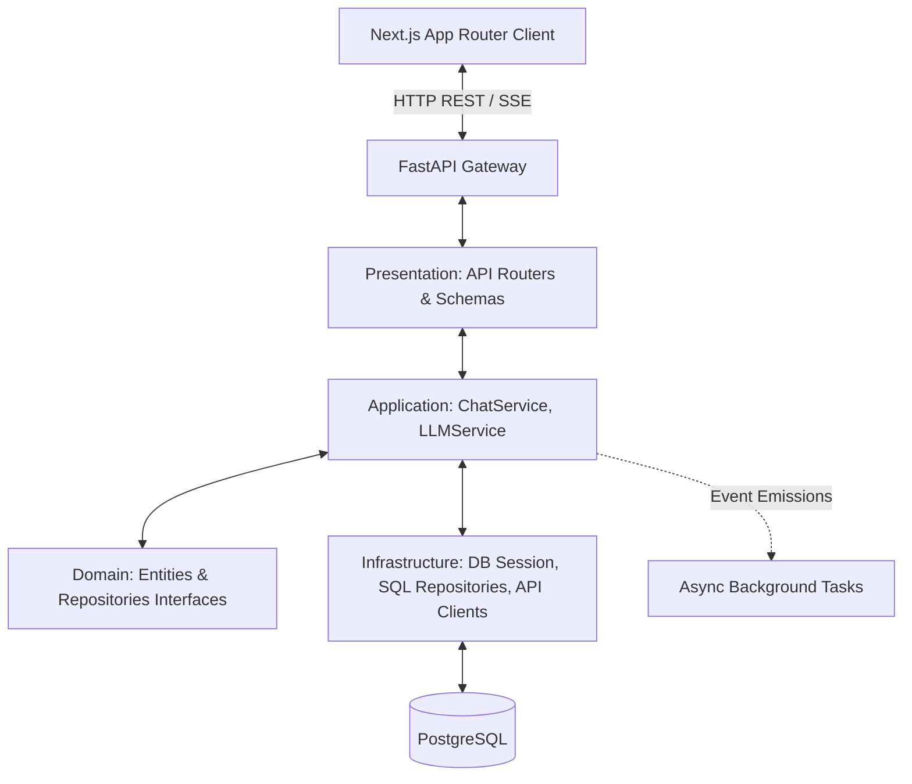
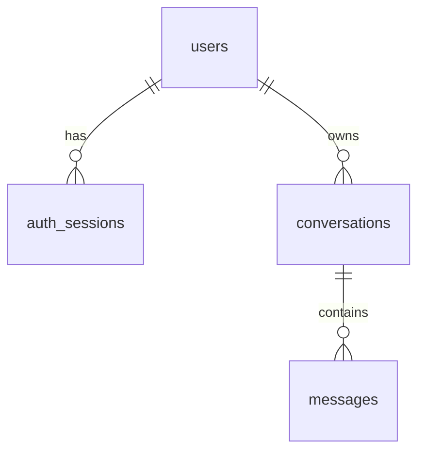
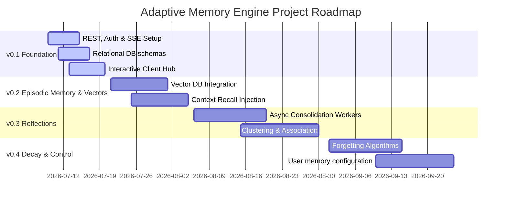

# Adaptive Memory Engine (AME) v0.1 — Foundation Design & Architectural Review

This implementation plan serves as a senior-level engineering blueprint and architectural critique for AME v0.1. Below is the full evaluation of our project constraints, our design patterns, and plans for growth.

---

## 1. Product Review

The goal of AME v0.1 is to establish a robust, scalable chat platform that forms the structural foundation for a long-term memory engine to be introduced in v0.2. While building a standard chat prototype first is a common development route, doing so without carefully designing the core database, APIs, and backend event hooks is a major source of refactoring debt.

### Under-the-Hood Gaps in Standard Chat Systems:
1. **Inefficient Post-processing hooks**: A typical chat platform behaves as a simple Request & Response loop. AME, however, is a cognitive machine. Every message sent must trigger classification, vector embeddings, entity extraction, semantic links, and periodic reflection. Doing this inside the main HTTP request thread would result in terrible response latency. We must implement an **asynchronous event-driven logging and ingestion pipeline** from Day 1.
2. **Context Enrichment Gap**: A standard chat backend constructs its LLM context window by fetching the last $N$ messages from the database. AME requires context *enrichment* (injecting recalled episodic, semantic, or personal context before it reaches the LLM). The backend cannot rely on standard database queries in the controller. It needs a dedicated `ContextBuilder` domain to query memory buffers.
3. **Tracking Message Memory Status**: To prevent the memory engine in v0.2 from parsing the entire message log repeatedly, v0.1 messages must track their memory classification status (e.g., whether a message has been processed, scheduled for consolidation, or ignored).

### Proposed Product Adjustments for v0.1:
- Introduce a **Memory Hook Interface** inside the conversation runner. In v0.1, this interface is a pass-through layer that does not alter messages. In v0.2, this will be the extension point for memory lookup.
- Include a **Memory Ingest Interface** running in an asynchronous background context (e.g., using FastAPI's background tasks or standard Python concurrency tools in the API gateway).
- **Establish Route and Component Skeletons**: Rather than rendering visual placeholder components that simulate unfinished functionality in v0.1, the application layout will use Next.js routing patterns to prepare for v0.2 dashboards (e.g., leaving a structural layout slot for a settings/memory page), keeping the current user experience focused purely on a high-fidelity chat interface.

---

## 2. Scope & Boundaries Review

A critical role of the Staff Engineer is to protect the project scope from feature creep. 

### In-Scope (v0.1 Foundation):
- Secure user authentication and session management.
- Multi-session chat conversations list.
- Reactive, high-performance web dashboard (Dark mode by default, support for Markdown, syntax-highlighted code blocks, and streaming feedback) leveraging **Next.js**, **Tailwind CSS**, and **Framer Motion**.
- Database schemas optimized for fast history lookups.
- Unified interface layers for LLMs and Memory services.

### Out-of-Scope (Postponed to v0.2/v0.3):
- **Vector Database (pgvector / Qdrant / Pinecone)**: Enabling embeddings and vector indices should wait until v0.2, but the application configuration will be structured to accept vector store configurations.
- **Distributed task managers (e.g., Redis + Celery / BullMQ)**: For v0.1, we will use lightweight, in-memory background worker threads. This keeps our development environment lightweight while keeping our architecture ready for production scaling.
- **Memory Consolidation & Recalling Algorithms**: No actual embedding generation or memory summaries.
- **Cognitive Inspector Panel**: Interface controls to view memory status or vector relations are deferred. The UI remains clean and focused solely on chat in v0.1, preventing UI clutter until the underlying engine is implemented.

---

## 3. Technical Architecture

The architecture relies on a decoupled, layered pattern using **Python + FastAPI** for the core backend services, and **Next.js + TypeScript + Tailwind CSS** for the client web interface.

### Language & Technology Stack Decisions:
1. **Frontend: Next.js (App Router), TypeScript, Tailwind CSS, Framer Motion**
   - *Server Components*: Next.js allows rendering static components (like outer layouts, sidebars, and chat headers) on the server, minimizing client bundles and optimization overhead.
   - *Future Scalability*: The App Router model organizes routes cleanly. We can scale from a simple `/chat` path to an administrative and diagnostic dashboard (e.g., `/settings/memory`, `/inspect/episodic`) without loading complex javascript bundles for standard users.
   - *Tailwind CSS*: Utility-first CSS speeds up layout development, maintains design consistency via tokens, and purges unused classes to keep build sizes small.
   - *Framer Motion*: Provides smooth page-state transitions and micro-interactions for a premium feel.
2. **Backend: Python + FastAPI + SQLAlchemy + Pydantic**
   - *Rationale*: The AI and machine learning ecosystem is predominantly Python-based. Since AME will interact with embeddings, NLP tokenizers, vector drivers, and LLMs in v0.2, writing the backend in Python avoids maintaining a dual-language stack. FastAPI provides high-speed asynchronous capabilities and automatic OpenAPI docs.
3. **Database: PostgreSQL**
   - *Rationale*: A relational database is ideal for structural relationships (Users, Sessions, Conversations, and Messages). PostgreSQL also supports `pgvector`, allowing us to store both vector memories and standard relational metadata in a single database in v0.2.



### Folder Directory Layout (DDD-Lite Architecture):
We recommend a layered **DDD-Lite (Domain-Driven Design)** backend structure to cleanly isolate core cognitive rules from FastAPI framework boundaries and database persistence.

```text
ame-workspace/
├── backend/
│   ├── app/
│   │   ├── domain/               # Enterprise logic: Database entities & repository interfaces
│   │   │   ├── entities.py
│   │   │   └── repositories.py
│   │   ├── application/          # Use cases and services: Chat, LLM, Auth orchestrators
│   │   │   ├── auth_service.py
│   │   │   ├── chat_service.py
│   │   │   └── llm_service.py
│   │   ├── infrastructure/       # Technologies and configurations: DB models, API clients, security helpers
│   │   │   ├── db/
│   │   │   │   ├── session.py
│   │   │   │   └── models.py     # SQLAlchemy models
│   │   │   ├── clients/
│   │   │   │   └── llm_client.py # Actual OpenAI/Anthropic stream implementations
│   │   │   ├── repositories/     # SQLAlchemy concrete repository patterns
│   │   │   │   └── sql_repos.py
│   │   │   └── security/
│   │   │       └── hashing.py
│   │   ├── presentation/         # Interfaces and delivery: FastAPI routers, validations, parameters
│   │   │   ├── api/
│   │   │   │   ├── auth.py
│   │   │   │   ├── chat.py
│   │   │   │   └── schemas.py    # Pydantic validation rules
│   │   │   └── main.py
│   │   ├── main.py               # Main FastAPI gateway entrypoint
│   │   └── config.py
│   ├── requirements.txt
│   └── tests/
├── frontend/
│   ├── src/
│   │   ├── app/                  # Next.js App Router (layout.tsx, page.tsx, chat/[id])
│   │   ├── components/           # Reusable UI elements (Sidebar, ChatBox, MessageCard)
│   │   │   ├── ui/               # Lower-level design primitives (Button, Dropdown, Dialog)
│   │   │   └── conversation/
│   │   ├── hooks/                # Dynamic custom hooks (useSession, useStream)
│   │   ├── lib/                  # Utilities (Tailwind merge helper, apiClient wrapper)
│   │   ├── store/                # Zustand client state
│   │   └── types/                # TypeScript interface mappings
│   ├── tailwind.config.ts
│   ├── tsconfig.json
│   ├── package.json
│   └── next.config.ts
```

---

## 4. Database Design (PostgreSQL Schema Concept)

To scale to millions of records, the database must maintain strict normalization and utilize specific indexing strategies.

### Database Tables:

#### 1. `users` Table
- `id`: `UUID` (Primary Key, Default: `gen_random_uuid()`)
- `email`: `VARCHAR(255)` (Unique, Not Null, Indexed)
- `password_hash`: `VARCHAR(255)` (Not Null)
- `created_at`: `TIMESTAMP WITH TIME ZONE` (Default: `NOW()`)
- `updated_at`: `TIMESTAMP WITH TIME ZONE` (Default: `NOW()`)

#### 2. `auth_sessions` Table
- `id`: `UUID` (Primary Key)
- `user_id`: `UUID` (Foreign Key -> `users.id` ON DELETE CASCADE)
- `token_hash`: `VARCHAR(64)` (Unique, Indexed) - Hash of the actual session cookie identifier.
- `expires_at`: `TIMESTAMP WITH TIME ZONE` (Not Null)
- `ip_address`: `VARCHAR(45)`
- `user_agent`: `TEXT`
- `created_at`: `TIMESTAMP WITH TIME ZONE` (Default: `NOW()`)

#### 3. `conversations` Table
- `id`: `UUID` (Primary Key)
- `user_id`: `UUID` (Foreign Key -> `users.id` ON DELETE CASCADE, Indexed)
- `title`: `VARCHAR(100)` (Not Null, Default "New Conversation")
- `system_prompt`: `TEXT` (Null, for conversation customization)
- `created_at`: `TIMESTAMP WITH TIME ZONE` (Default: `NOW()`)
- `updated_at`: `TIMESTAMP WITH TIME ZONE` (Default: `NOW()`)

#### 4. `messages` Table
- `id`: `UUID` (Primary Key)
- `conversation_id`: `UUID` (Foreign Key -> `conversations.id` ON DELETE CASCADE)
- `sender_role`: `VARCHAR(20)` (Check Constraint: `user`, `assistant`, `system`)
- `content`: `TEXT` (Not Null)
- `memory_status`: `VARCHAR(20)` (Default: `pending`, Check Constraint: `pending`, `consolidated`, `ignored`)
- `created_at`: `TIMESTAMP WITH TIME ZONE` (Default: `NOW()`)

### Optimization Indexes & Constraints:
- **Index `idx_messages_conversation_sequence`**: Composite index on `(conversation_id, created_at ASC)`. Critical for paginated retrieval of chat logs.
- **Index `idx_messages_unprocessed_memory`**: Partial index on `(id)` where `memory_status = 'pending'`. Avoids full table scans when background memory workers run.
- **Index `idx_sessions_expiry`**: Single field B-Tree on `expires_at` to facilitate clean-up of expired cookies.



---

## 5. API Design

The API uses standard REST for setup operations, and Server-Sent Events (SSE) for streaming message completions.

### Core Endpoints:

#### 1. Authentication
*   `POST /api/v1/auth/register`
    *   *Body*: `{ "email": "user@domain.com", "password": "SecurePassword" }`
    *   *Response*: `201 Created` with HttpOnly cookie setting.
*   `POST /api/v1/auth/login`
    *   *Body*: `{ "email": "user@domain.com", "password": "SecurePassword" }`
    *   *Response*: `200 OK` (Sets cookie session identifier).
*   `POST /api/v1/auth/logout`
    *   *Response*: `204 No Content` (Invalidates session in database, clears cookie).

#### 2. Conversations
*   `GET /api/v1/conversations` (Paginated list of active user's conversations)
    *   *Query*: `?page=1&limit=20`
    *   *Response*: `200 OK`, JSON array with title, creation timestamps, and IDs.
*   `POST /api/v1/conversations` (Creates a blank chat canvas)
    *   *Body*: `{ "title": "Optional Title", "system_prompt": "Optional System Prompt" }`
*   `DELETE /api/v1/conversations/{id}`
    *   *Response*: `204 No Content`

#### 3. Messages & Streams (The Ingestion Loop)
*   `GET /api/v1/conversations/{id}/messages` (Fetches message list)
    *   *Query*: `?before_id={UUID}&limit=50` (Cursor-based pagination prevents offset rendering errors during streaming)
*   `POST /api/v1/conversations/{id}/messages` (Submits a user message and streams assistant reply)
    *   *Body*: `{ "content": "Tell me about memory systems." }`
    *   *Response Header*: `Content-Type: text/event-stream`
    *   *Response Stream*:
        1.  `event: message_id` (Returns DB UUID of newly created database assistant response message)
        2.  `event: delta` (Text fragments as they arrive from downstream LLM provider)
        3.  `event: done` (Signals execution end, returns metadata token count)

### Validation & Error Handling:
- Request objects will have schema validation enforced using Pydantic.
- Error payloads will follow a strict standard format:
  ```json
  {
    "error_code": "RESOURCE_NOT_FOUND",
    "message": "Conversation with id UUID was not found.",
    "details": {}
  }
  ```

---

## 6. Frontend UI/UX Design

The application will feature a dark-themed UI built with Next.js and Tailwind CSS. The design moves away from decorative glassmorphism in favor of a clean, structured interface.

### Design Philosophy:
- **Minimal & Editorial**: A simple layout focusing on structure. Inspired by the layouts of Notion, Claude, Apple, and Linear.
- **Visual Hygiene**: High-contrast, clean layout using whitespace, precise line-heights, and clear typographic hierarchy.
- **Color Palette**: Sophisticated monochromatic scale (rich grays/slates `bg-neutral-950`, borders `border-neutral-800`, text `text-neutral-100`, accents `text-neutral-400`).
- **Accessibility (a11y)**: Proper color-contrast ratios, focus status outlines, full keyboard traversal compatibility, and readable sans-serif typefaces (e.g., Outfit or Inter).

### Visual Layout:
- **Left Panel (Sidebar)**: List of conversations, collapsible menu options, create-new-conversation button, user configuration access.
- **Center Panel (Chat Canvas)**: Dynamic view component. Includes an auto-scrolling message list with support for markdown rendering and code syntax highlighting. Includes a message input area that dynamically adjusts its height based on input length.
- **No v0.1 Cognitive Panel**: Left panel and main chat canvas comprise the entire viewport. Setting options are reserved for a structural `/settings` layout slot within Next.js routing, keeping components unburdened by mock memory logic.

```text
+-----------------------------------------------------+
| Sidebar        | Active Conversation Canvas         |
|----------------|------------------------------------|
| [New Chat]     |          System Prompt bar         |
|                | ---------------------------------- |
| Chat 1 Title   | User: Hello!                       |
| Chat 2 Title   | AI: Hello. How can I help today?   |
|                |                                    |
|                |                                    |
| [Profile / Out]| [Text area input                 >]|
+-----------------------------------------------------+
```

### State Management Strategy:
- **Zustand Store**: We will track active UI sessions, configuration settings, conversations records, and ongoing text generation streams. This keeps state out of the react component tree to prevent unnecessary re-renders.

### Key Micro-interactions (Framer Motion):
- Smooth component entries and list transitions (e.g. loading animations, message cards entering view).
- Hover highlights on active paths using neutral overlays.
- Key bindings (`Cmd/Ctrl + Enter` to commit, `Esc` to close overlay templates).

---

## 7. Backend Design & Abstractions

To ensure future-proofing for v0.2 memory features, we will use a **layered DDD-lite architecture** inside FastAPI.

```
       +---------------------------------------------+
       |               Presentation                  |
       |         (FastAPI Routers & Schemas)         |
       +----------------------+----------------------+
                              |
                              v
       +----------------------+----------------------+
       |                Application                  |
       |       (ChatUseCase, LLMUseCase, Services)   |
       +-------+--------------+---------------+------+
               |              |               |
               v              v               v
  +------------+---+  +-------+------+  +-----+------+
  |     Domain     |  |    Domain    |  |Infrastructure|
  | MemoryService  |  |  LLMService  |  |Repositories  |
  |  (Interface)   |  | (Interface)  |  | (SQLAlchemy) |
  +----------------+  +--------------+  +------------+
```

### Decoupled Service Contracts:

#### 1. `MemoryService` (Interface Proxy in `domain/repositories.py`)
```python
class IMemoryService:
    async def enrich_context(self, user_id: str, user_query: str) -> list[str]:
        """Queries memory indexes (Wait for v0.2). Returns matching reference facts."""
        raise NotImplementedError()

    async def enqueue_ingest(self, message_id: str) -> None:
        """Sends message to background queue for memory consolidation (Wait for v0.2)"""
        raise NotImplementedError()
```
*   *In v0.1*: `enrich_context` returns an empty array, and `enqueue_ingest` triggers a basic logger statement. This allows us to integrate the memory backend later with zero changes to the application services.

#### 2. `LLMService` (OpenAI / Local Client Interface in `domain/repositories.py`)
```python
class ILLMService:
    async def generate_stream(self, system_prompt: str, prompt_messages: list[dict]) -> AsyncGenerator[str, None]:
        """Abstracts vendor APIs (OpenAI, Anthropic, Ollama)."""
        raise NotImplementedError()
```

### Error Handling & Logging:
- Global exception handler maps backend exceptions (such as authentication or database errors) to standard HTTP error codes.
- Structured, JSON-formatted logging is written to stdout. This makes it easy for diagnostic tools to parse runtime events and trace request processes.

---

## 8. Security Review

1. **Authentication Policy**:
   - Use secure, cross-site, `HttpOnly`, `SameSite=Lax` cookies to store authorization session keys. This eliminates script execution vulnerabilities (XSS) where local-storage tokens can be read by external scripts.
2. **Password Hashing**:
   - Standardize on **Argon2id** (via `passlib` configuration) for secure password storage.
3. **API Rate Limiting**:
   - Implement temporary rate-limiting using sliding-window token buckets. Limits will be set to:
     - Auth actions: 10 calls per minute per IP.
     - Conversation stream endpoint: 30 generations per minute per IP.
4. **Input Constraints & Sanitization**:
   - Enforce constraints on message payloads (e.g., maximum length of 10,000 characters to prevent buffer issues).
   - Sanitize HTML in the React rendering pipeline to prevent cross-site scripting vulnerabilities.

---

## 9. Architectural Risks & Mitigations

### 1. Unified Backend Threads on Stream Delivery
- *Risk*: Streaming text keeps HTTP connections open for long periods. If we use a single-threaded server setup, a few slow connections could block other API requests.
- *Mitigation*: We will configure our FastAPI backend using fully asynchronous database drivers (`asyncpg` via SQLAlchemy) and deploy the system using a multiplexing ASGI server like Uvicorn.

### 2. Next.js Client Hydration Sync
- *Risk*: Discrepancies between markup rendered on server (SSR) and hydrated on client (like layout formats or locale dates) throw React runtime errors.
- *Mitigation*: Design layout frames as pure client components where data fetches occur (`use client`), keeping base server wrappers static, and use dynamic loading stubs options where necessary.

### 3. Context Window Cost Inflation
- *Risk*: Sending full chat history to the LLM increases token costs and latency as conversations grow.
- *Mitigation*: In v0.1, we will implement cursor-based pagination and limit the sliding chat history context to the last 15 messages. In v0.2, the long-term memory engine will let us retrieve only relevant past information, allowing us to keep context windows minimal.

### 4. Database lockup during memory processing
- *Risk*: When the memory engine runs in v0.2, it will perform complex queries and writes to consolidate information. If these run on the main database thread, they could slow down the chat experience for active users.
- *Mitigation*: In v0.1, we will create indexes with a clean query separation strategy (using partial indexes for unprocessed messages). This ensures memory workers can fetch data quickly without locking main tables.

---

## 10. Architecture Decision Records (ADRs)

### ADR 01: Why Next.js (App Router)?
*   **Decision**: Standardize frontend development on Next.js 14+ (App Router) using React Server Components (RSC) and dynamic builds.
*   **Alternatives Considered**: React SPA with Vite.
*   **Advantages**:
    - *React Server Components*: Initial render loads on the server, stripping Markdown parsing logic and HTML boilerplate from the client JS bundle.
    - *Page Routing Structure*: Native file-system routing simplifies the addition of `/settings/memory`, `/dashboard/inspect`, and core chat pages without complex routing configurations.
    - *Security*: Router middleware can intercept sessions before page loading, avoiding client-side layout shifts and keeping routes secure.
*   **Disadvantages**:
    - Higher learning curve compared to Vite, especially regarding hydration limits and separate client/server state boundaries.
*   **Final Justification**: Moving from chat in v0.1 to a full cognitive dashboard in v0.2 requires scale. Next.js provides the best deployment pipeline, native routing boundaries, and optimization tooling to keep development fast and production-ready.

### ADR 02: Why FastAPI?
*   **Decision**: Implement the core business backend in Python using the FastAPI framework.
*   **Alternatives Considered**: Node.js/Express, Go.
*   **Advantages**:
    - Native compatibility with machine learning, embedding models, Vector DB wrappers, or LLM agent toolsets.
    - Highly efficient ASGI async request loop performance.
    - Automated schemas and OpenAPI documentation compilation.
*   **Disadvantages**:
    - Python applications consume more memory during high workloads compared to Go or Rust.
*   **Final Justification**: Since AME's main functionality relies on ML models, Python is the logical choice. FastAPI gives us high performance and allows team members to build features unified under a single language.

### ADR 03: Why PostgreSQL?
*   **Decision**: Utilize PostgreSQL as our SQL transaction database.
*   **Alternatives Considered**: SQLite, MongoDB, DynamoDB.
*   **Advantages**:
    - High transactional safety, ACID compliance, and excellent indexing constraints.
    - Native support for pgvector, allowing relational meta-logs and vector embeddings to reside in one server instance.
*   **Disadvantages**:
    - Requires database migration overhead (using Alembic) and careful connection pool configurations.
*   **Final Justification**: The structures of profiles, chat sessions, and messages are highly relational. By deploying PostgreSQL, we gain relational features in v0.1 and can easily support vector storage in v0.2 without changing database engines.

### ADR 04: Why REST APIs?
*   **Decision**: Standardize basic write/read processes using HTTP REST specifications.
*   **Alternatives Considered**: GraphQL, gRPC.
*   **Advantages**:
    - Standard convention, easy to audit, low payload overhead, and supported natively by all edge firewalls/gateways.
*   **Disadvantages**:
    - Risk of over-fetching data unless schemas are configured tightly.
*   **Final Justification**: REST endpoints are ideal for the classic CRUD requirements of v0.1 (user registration, listing conversations, deleting messages), while text streaming is handled separately.

### ADR 05: Why Repository Pattern?
*   **Decision**: Abstract database access using Repository specifications.
*   **Alternatives Considered**: Writing raw SQL/ORM query blocks directly in Controller routes.
*   **Advantages**:
    - Decouples core business services from direct database library implementations.
    - Simplifies unit testing by allowing developers to mock database queries.
*   **Disadvantages**:
    - Requires extra boilerplate and interfaces.
*   **Final Justification**: Isolating database operations ensures the core application logic remains decoupled. If we scale PgSQL or migrate to an enterprise data layer in v0.3, the core chat logic won't need to change.

### ADR 06: Why Service Layer?
*   **Decision**: Standardize application use cases and business rules inside a distinct Application Service Layer handler.
*   **Alternatives Considered**: Injecting business operations inside Controller route functions.
*   **Advantages**:
    - Keeps controllers thin, focusing them solely on checking parameters and formatting responses.
    - Provides a single location to organize multi-step routines (like loading chat history, setting prompts, calling the model, and storing messages).
*   **Disadvantages**:
    - Creates another file boundary layer.
*   **Final Justification**: Because AME v0.2 needs to inject memory lookups right before sending queries to the LLM, the core chat logic must be clean. The service layer is the perfect abstraction boundary to handle this.

### ADR 07: Why Server-Sent Events (SSE)?
*   **Decision**: Deliver assistant text response streams to clients using Server-Sent Events (SSE).
*   **Alternatives Considered**: WebSockets, Long Polling.
*   **Advantages**:
    - *Unidirectional Stream*: LLM output is entirely server-to-client, matching SSE's design.
    - *Native browser support*: Native browser `EventSource` handles connection drops and automatic retries out of the box.
    - *Infrastructure compatibility*: Operates over standard HTTP/1.1 or multiplexed HTTP/2 without socket starvation, firewall issues, or complex socket state managers.
*   **Disadvantages**:
    - *Uni-directional*: Cannot easily send structured payloads from client to server during a active connection.
    - *HTTP/1.1 Limits*: Standard browsers limit concurrent connections to 6 per domain when utilizing HTTP/1.1 (mitigated by HTTP/2).
*   **Final Justification**: AME's core streaming requirement is unidirectional assistant output. SSE is simple to implement, handles connection drops natively, and avoids the stateful connection overhead associated with WebSockets.

### ADR 08: Why Tailwind CSS?
*   **Decision**: Style frontend pages using utility-first Tailwind CSS classes.
*   **Alternatives Considered**: CSS Modules, Styled Components, Vanilla CSS.
*   **Advantages**:
    - Fast visual iterations right inside the markup.
    - Zero scaling CSS bundle pollution.
    - Eliminates class naming conflicts.
*   **Disadvantages**:
    - Leads to long, cluttered class lists in the HTML template code if components aren't structured well.
*   **Final Justification**: Tailwind CSS is a robust choice for rapidly iterating on our Notion/Claude-inspired design system. It allows us to manage themes, layouts, and typography consistently using utility classes.

---

## 11. Version Roadmap



- **v0.1 — Foundation**:
  - Implement authentication, chat UI, structured schema, streaming endpoints, and interface contracts for memory services.
- **v0.2 — Retrieval & Vector Store**:
  - Connect a Vector Database (e.g., pgvector) and implement text embeddings.
  - Implement `enrich_context` logic to retrieve relevant information based on user messages.
  - Deploy the cognitive dash control route (`/dashboard/memory`) inside the Next.js routing system.
- **v0.3 — Reflection & Consolidation**:
  - Build background consolidation tasks to summarize chat sessions into permanent memories during off-peak hours.
  - Group related episodic memories into semantic knowledge graphs.
- **v0.4 — Forgetting & Management**:
  - Implement memory decay rates based on time elapsed and retrieval frequency.
  - Add user tools to search, edit, and delete stored memories.

---

## Verification Plan (v0.1 Validation)

### Automated Integration Tests
- **Endpoint Tests**: Run FastAPI client integration tests for authentication, conversation creation, and message streaming.
  ```bash
  pytest tests/
  ```

### Manual Verification
- Verify the responsiveness of our streaming chat interface under simulated network latency. This ensures client components render text smoothly without blocky animations or layout shifts.
